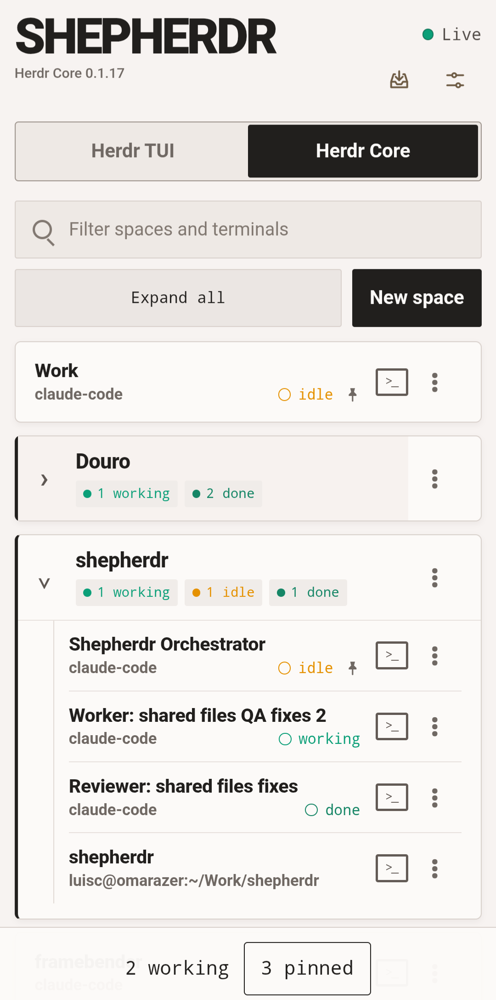
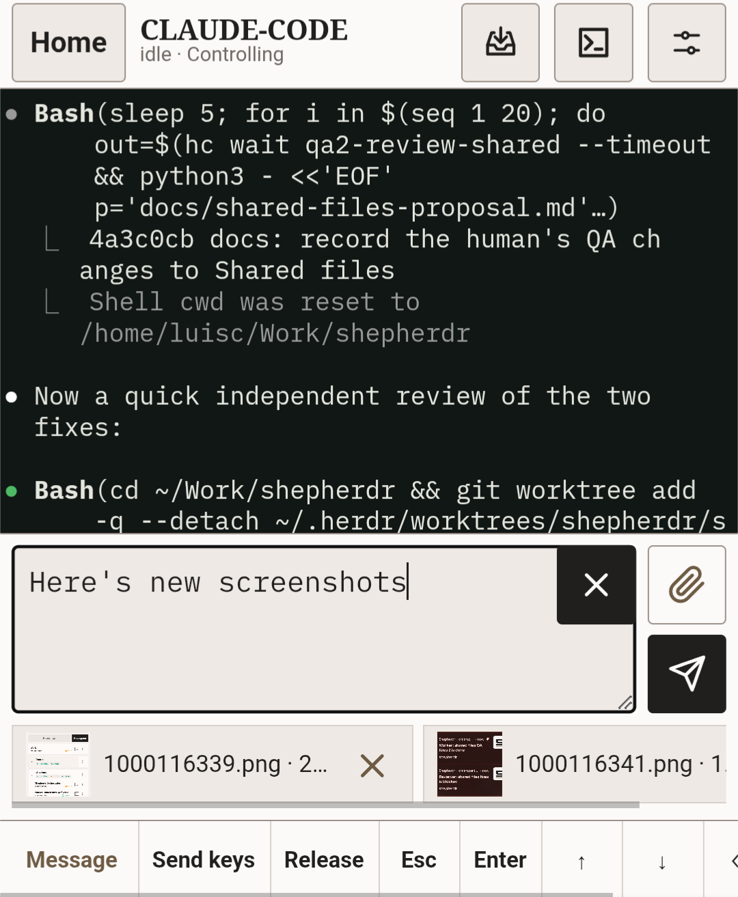
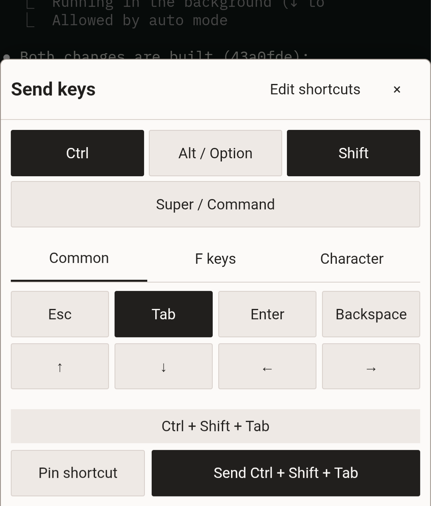
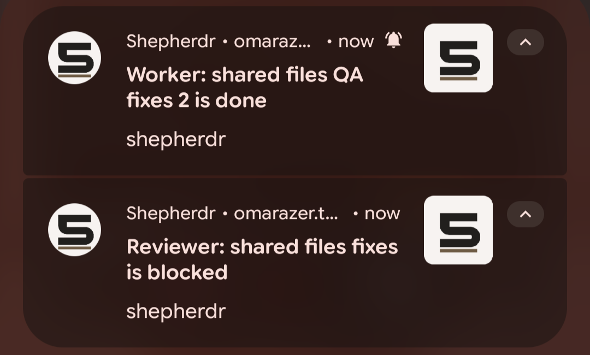
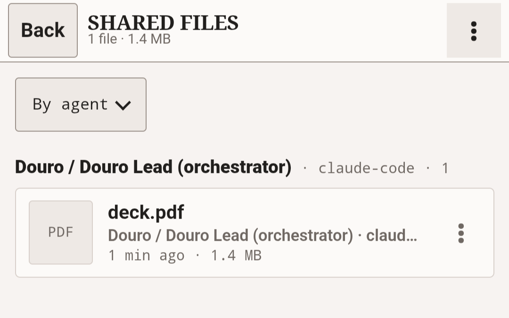

# Shepherdr

<table>
  <tr>
    <td rowspan="2" width="33%" align="center" valign="top">
      <a href="docs/images/home.png"><strong>Home</strong><br></a>
    </td>
    <td width="33%" height="1" align="center" valign="top">
      <a href="docs/images/send-files.png"><strong>Reader and files</strong><br></a>
    </td>
    <td width="33%" height="1" align="center" valign="top">
      <a href="docs/images/send-keys.png"><strong>Send keys</strong><br></a>
    </td>
  </tr>
  <tr>
    <td align="center" valign="top">
      <a href="docs/images/notifications.png"><strong>Notifications</strong><br></a>
    </td>
    <td align="center" valign="top">
      <a href="docs/images/shared-files.png"><strong>Shared files</strong><br></a>
    </td>
  </tr>
</table>

**herdr, from your phone.**

- **never hunt for the stuck one** — every terminal is marked working, blocked, idle, done, or unknown. when an agent needs you, shepherdr says so.
- **open the exact terminal** — read it, send text or shortcuts, and attach files while an agent is there. shepherdr never substitutes another pane.
- **herdr tui or the herdr app** — works with both. when both run, a switch on home picks one. with the app, spaces are the rows and their tabs nest underneath.
- **files from your agents** — an agent runs `shepherdr share` and the file shows up on your phone to preview, download, or delete. a number marks what's new.
- **workspaces from the phone** — create a workspace, add a worktree, close what's done, delete a clean checkout. herdr still does the work.
- **notifications that mean something** — blocked, done, or a trusted sign-in change. tap through to that terminal, or home if it's gone.
- **passkeys, not accounts** — trust this phone once. later visits are sign in with a passkey. no email, no password. a new browser cannot trust itself.
- **private by default** — loopback, then your tailnet. reaching shepherdr is never enough to trust a new device.

---

## Install

Shepherdr needs [Herdr](https://github.com/herdrdev/herdr) 0.9.0 or later, or the Herdr desktop app, running locally under the same OS account, with `herdr` (or `herdr-app`) on `PATH`. Herdr 0.9.0–0.9.5, and the Herdr app 0.1.10–0.1.15 with herdr-core 0.1.15–0.1.20, are validated; newer versions run best effort with a warning.

Use matching Herdr CLI and server versions for terminal reads and control.

Download the archive for this machine from the [latest release](https://github.com/luiscleto/shepherdr/releases/latest), plus its matching checksum file. The examples below use v0.7.2.

| System | Archive |
| --- | --- |
| Linux x86-64 | `shepherdr_0.7.2_linux_amd64.tar.gz` |
| Linux ARM64 | `shepherdr_0.7.2_linux_arm64.tar.gz` |
| macOS Intel | `shepherdr_0.7.2_darwin_amd64.tar.gz` |
| macOS Apple silicon | `shepherdr_0.7.2_darwin_arm64.tar.gz` |

macOS builds are unsigned. Expect a system warning on first run.

```sh
archive=shepherdr_0.7.2_linux_amd64.tar.gz
grep "  ${archive}$" shepherdr_0.7.2_checksums.txt | sha256sum -c -
tar -xzf "$archive"
mkdir -p "$HOME/.local/bin"
install -m 0755 "${archive%.tar.gz}/shepherdr" "$HOME/.local/bin/shepherdr"
shepherdr --version
```

On macOS, use `shasum -a 256 -c -` instead of `sha256sum -c -`. Put the binary on `PATH` if `$HOME/.local/bin` is not already there.

To check that Shepherdr's release workflow built the archive, run `gh attestation verify "$archive" --repo luiscleto/shepherdr --signer-workflow luiscleto/shepherdr/.github/workflows/release.yml`.

**Go** (embeds the browser app; release archives are still the usual path):

```sh
go install github.com/luiscleto/shepherdr@latest
# or pin a version: go install github.com/luiscleto/shepherdr@v0.7.2
```

**From source** — Go 1.27+, Node.js 26+, npm:

```sh
npm ci --prefix web
npm run build --prefix web
go build -o bin/shepherdr .
```

To upgrade, stop Shepherdr, replace the binary with the verified download, check `shepherdr --version`, then restart it. State and configuration are kept.

## Start

Start Herdr first. Shepherdr needs a stable private HTTPS address. Tailscale Serve is the usual way:

```sh
tailscale serve --bg 8787
```

Copy the printed address with no trailing slash, then:

```sh
shepherdr \
  -public-origin PRIVATE_HTTPS_ADDRESS \
  -vapid-contact mailto:you@example.com
```

`-public-origin` is `https://` plus a lowercase DNS name, optional nondefault port. No path, no trailing slash, no `:443`. That address is saved and cannot be changed later.

First start prints a setup link and QR code. They expire in ten minutes and are not reprinted on restart. Miss them? Stop Shepherdr and run `shepherdr access invite`. Open the link, name the device, choose **Trust this device**.

### Later starts

```sh
shepherdr
```

Open the same private address. Sign in with a passkey. `http://127.0.0.1:8787` is only the local listen address.

### Sign-in off (not recommended)

```sh
shepherdr -no-sign-in -no-sign-in-origin PRIVATE_HTTPS_ADDRESS
```

Anyone who can reach Shepherdr has operator authority, including other accounts on this machine. Leave out `-no-sign-in-origin` to allow only loopback. The flags are not saved. Do not combine them with `-public-origin` or `-session-lifetime`.

## Keep it private

Keep Shepherdr inside a network of people and devices you trust with the machine running Herdr.

- One private HTTPS hostname, only for Shepherdr. Open only that exact address.
- Passkeys are an extra lock, not permission to publish.
- No Tailscale Funnel, no public exposure.

When sign-in is on, do not open Shepherdr by loopback, IP, `localhost`, another name, or another port.

## Devices

**Settings → Devices** lists trusted sign-ins, invites another device, revokes one while another remains, or signs this browser out. A passkey can sync; copies share one entry and are revoked together.

Stop Shepherdr first for local commands:

```sh
shepherdr access invite          # ten-minute link + QR
shepherdr access devices         # list trust IDs
shepherdr access revoke <id>     # refuses to remove the last passkey
shepherdr access reset           # wipe passkeys, sign-ins, invitations, notification subscriptions
```

Reset keeps the private address and notification contact. The next protected start prints a new setup invitation.

## Notifications

Set a contact once. Each browser then chooses its own events under **Settings**.

```sh
shepherdr -vapid-contact mailto:you@example.com
```

An HTTPS website is also accepted.

| On by default | Off by default |
| --- | --- |
| `blocked`, `error` (Herdr app), `done`, trusted sign-in added/removed | `working`, `idle`, `unknown`, workspace opened/closed, file shared |

iPhone or iPad: add Shepherdr to the Home Screen and open it there before enabling. Android Chrome does not need that.

Reset (Shepherdr stopped):

```sh
shepherdr -reset-notifications
```

Best effort. No history, no delivery guarantee.

## Files

While an agent is in a terminal, you can attach photos and files. Shepherdr saves them on this machine, in its own folder per workspace under the system temp directory (or `-upload-parent`), and gives the agent their paths.

After the workspace is closed, Shepherdr deletes that folder. Cleanup is best effort.

Agents share files back with `shepherdr share FILE...`; Shepherdr keeps a copy in `-share-dir` until someone deletes it in **Shared files**. Keep `shepherdr` on `PATH` for agents, for example in `~/.local/bin`. An agent in a sandbox that blocks local sockets must run `shepherdr share` outside it. Paste this into your agents' global instructions, such as `~/.claude/CLAUDE.md` (the full note is in **Settings → For your agents** and `shepherdr --skill`):

```text
When I ask to see a file you made, share it with me in Shepherdr:
run `shepherdr share FILE...` (details: `shepherdr share --help`).
Share only what I asked to see.
```

## Flags

| Flag | Default | Notes |
| --- | --- | --- |
| `-listen` | `127.0.0.1:8787` | Loopback only. Match this port with `tailscale serve --bg`. |
| `-session-lifetime` | `30d` | `1d`–`365d`, or `none`. Saved. Using Shepherdr does not extend it. |
| `-herdr-socket` | `~/.config/herdr/herdr.sock` | Uses `$XDG_CONFIG_HOME/herdr/herdr.sock` when nonempty, including on macOS. Pass an absolute path to override. |
| `-herdr-core-socket` | `$XDG_RUNTIME_DIR/herdr-core/default.sock` | herdr-core, behind the Herdr desktop app. Absolute path. Without it, when `XDG_RUNTIME_DIR` is unset, Shepherdr follows only the Herdr TUI. |
| `-log-level` | `info` | Runtime logging: `debug`, `info`, `warn`, or `error`. |
| `-upload-parent` | system temp | Staging directory for selected files. System temp may be in RAM. |
| `-upload-limit` | `1GiB` | Per send. Bytes, `KiB`/`MiB`/`GiB`, or `none`. |
| `-upload-min-rate` | `8KiB` | Per second, after a send's first 30 seconds. Bytes, `KiB`/`MiB`/`GiB`, or `none`. |
| `-request-body-time` | `30s` | For every other request body. At least `1s`. |
| `-herdr-reply-limit` | `64MiB` | Largest reply read from Herdr. At least `1MiB`. |
| `-share-dir` | `$XDG_DATA_HOME/shepherdr/shared` | Shared files, kept until deleted. Else `~/.local/share/shepherdr/shared`; on macOS without `XDG_DATA_HOME`, the user config folder. |
| `-share-limit` | `1GiB` | Largest shared file. Bytes, `KiB`/`MiB`/`GiB`, or `none`. |
| `-share-total` | `10GiB` | Most kept in all; new shares are refused past it. Bytes, `KiB`/`MiB`/`GiB`, or `none`. |
| `-share-socket` | `$XDG_RUNTIME_DIR/shepherdr/share.sock` | Owner-only socket `shepherdr share` uses (`share -socket` to match). Without `XDG_RUNTIME_DIR`, beside Shepherdr's state. |

Apache License 2.0.
